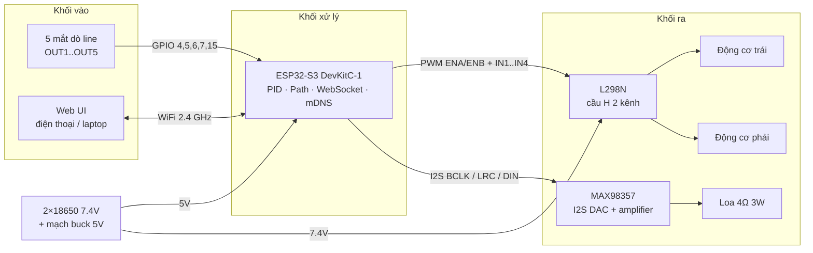
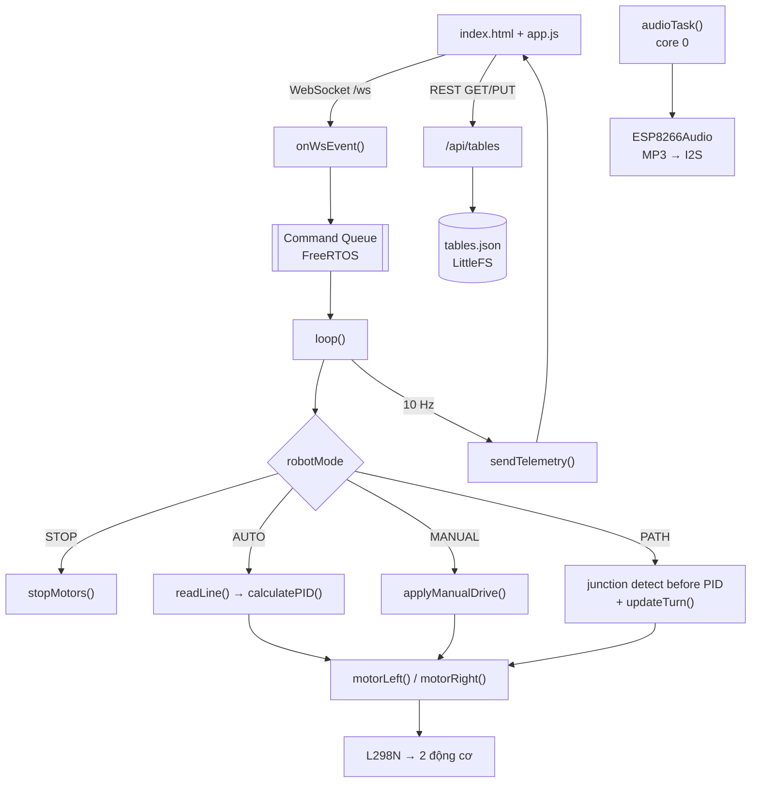
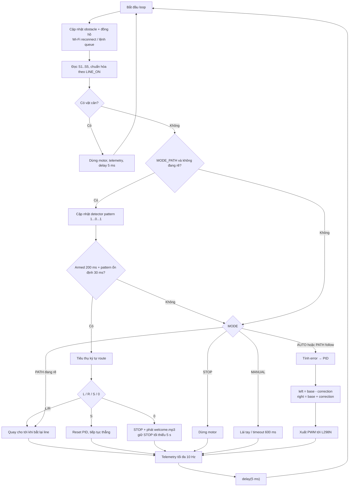
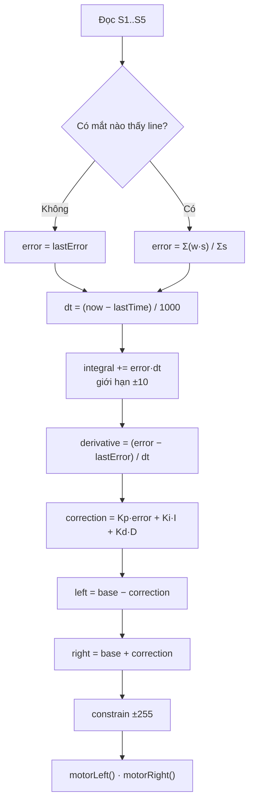
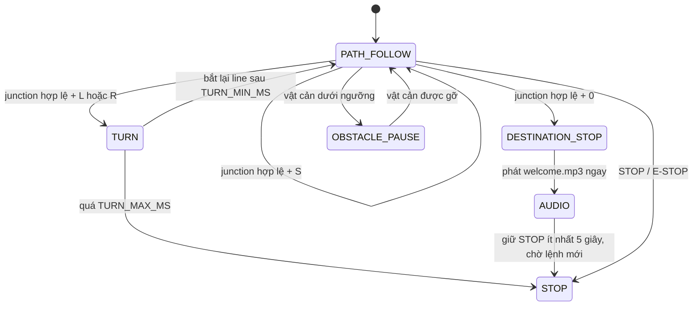

# BÁO CÁO SƠ BỘ

## XE TỰ HÀNH DÒ LINE, ĐIỀU KHIỂN QUA WEB VÀ CHỌN ĐIỂM ĐẾN

| | |
|---|---|
| **Môn học** | IoT / Hệ thống nhúng |
| **Nhóm** | ................................ |
| **Thành viên** | ................................ |
| **Giảng viên hướng dẫn** | ................................ |
| **Ngày báo cáo** | ....../....../2026 |
| **Phiên bản** | 0.1 — báo cáo sơ bộ (preliminary) |

---

## TÓM TẮT 60 GIÂY (dùng để mở đầu buổi thuyết trình)

> Nhóm em xây dựng firmware cho xe dò line dùng **ESP32-S3**, 5 cảm biến số và hai động cơ DC qua L298N. Ở AUTO/PATH, firmware tính vị trí line có trọng số và dùng PID để hiệu chỉnh hai bánh. Web UI giao tiếp qua Wi-Fi/WebSocket để quan sát telemetry, chỉnh PID, lái tay và chọn mã điểm đến như `L0`.
>
> Firmware còn có quản lý bảng điểm đến trên LittleFS, phát MP3 qua MAX98357, đồng bộ giờ NTP lên TM1637 và tạm dừng động cơ khi HY-SRF05 phát hiện vật cản gần. **Các tính năng đã được biên dịch nhưng chưa được xác nhận đầy đủ trên robot. Đặc biệt, lần thử nghiệm gần nhất do người dùng báo cáo cho biết robot vẫn chưa phát hiện ngã rẽ; nguyên nhân chưa được xác định.** Vì vậy báo cáo phân biệt triển khai trong mã nguồn với kết quả kiểm thử thực nghiệm.

---

## 1. MỤC TIÊU VÀ PHẠM VI

### 1.1 Mục tiêu

1. Xây dựng xe tự hành bám line ổn định bằng PID trên nền ESP32-S3.
2. Điều khiển và giám sát xe qua web realtime (WebSocket), không cần app riêng.
3. Bổ sung khả năng **đi đến điểm đích theo mã đường đi** thay vì chỉ bám line liên tục.
4. Phát âm thanh (MP3) ngay trên xe, độc lập với vòng điều khiển động cơ.

### 1.2 Phạm vi báo cáo sơ bộ

| Hạng mục | Trạng thái |
|---|---|
| Mã nguồn firmware (PID, 4 mode, web, điểm đến, audio, NTP, obstacle) | Có trong source; PlatformIO build đã thành công |
| Giao diện web và tài nguyên LittleFS | Có trong `data/`; cần nạp filesystem và kiểm tra trên board |
| Đấu nối phần cứng | Bảng GPIO theo sơ đồ người dùng cung cấp; chưa có bằng chứng đo/kiểm tra toàn bộ kết nối trong phiên này |
| Bám line và điều khiển động cơ trên sa bàn | Chưa có kết quả kiểm thử định lượng |
| Phát hiện ngã rẽ/đi tuyến | Chưa đạt theo thử nghiệm gần nhất người dùng báo cáo; cần chẩn đoán tiếp |
| Remote hồng ngoại VS1838B | Chưa tích hợp trong firmware hiện tại |
| Đo tốc độ bằng encoder | Chưa có |

---

## 2. YÊU CẦU CHỨC NĂNG

| Mã | Yêu cầu | Cách đáp ứng |
|---|---|---|
| FR-01 | Tự bám line | 5 mắt số + PID vị trí; vòng lặp có `delay(5 ms)` nhưng chu kỳ thực chưa đo |
| FR-02 | Chỉnh PID khi đang chạy | Slider Kp/Ki/Kd + base speed trên web |
| FR-03 | Lái tay 8 hướng | Nút D-pad / phím mũi tên, tự dừng sau 600 ms mất lệnh |
| FR-04 | Dừng bằng lệnh E-STOP trên web | Lệnh queue được xử lý trong `loop()`; thời gian đáp ứng chưa đo. Đây chưa phải nút dừng phần cứng độc lập |
| FR-05 | Giám sát realtime | Telemetry 10 Hz: 5 cảm biến, error, PID, tốc độ, mode, IP, RSSI |
| FR-06 | Chọn điểm đến | Gửi `id`, xe tra bảng mã và chạy chế độ PATH |
| FR-07 | Quản lý bảng điểm đến | Thêm/sửa/xoá trên web, lưu `/tables.json` |
| FR-08 | Phát nhạc | Nút loa trên web, MP3 trong `/audio/` |
| FR-09 | Truy cập không cần IP nhớ | mDNS `http://robot.local` + in IP ra Serial |
| FR-10 | Tự rẽ theo mã | Đã triển khai detector/state machine; kiểm thử trên robot hiện chưa đạt, nguyên nhân chưa rõ |

**Yêu cầu phi chức năng/giới hạn đo:** telemetry được giới hạn danh nghĩa 100 ms/lần; vòng `loop()` hiện nghỉ 5 ms ở cuối nhánh điều khiển, nhưng thời gian xử lý và tần số lấy mẫu thực chưa được đo. Audio giải mã trong task riêng để tránh chủ động chặn `loop()`. Tốc độ Wi-Fi và cấu hình nguồn nêu ở đây là cấu hình thiết kế, không phải kết quả đo hiệu năng.

---

## 3. KIẾN TRÚC HỆ THỐNG

### 3.1 Sơ đồ khối tổng thể



### 3.2 Phân rã phần mềm



**Điểm thiết kế đáng chú ý:** WebSocket chạy trong task của thư viện async, còn điều khiển động cơ chạy trong `loop()`. Hai bên **không gọi trực tiếp** vào nhau mà trao đổi qua **hàng đợi lệnh FreeRTOS**, tránh tranh chấp và tránh việc một gói tin web làm sai nhịp PID.

### 3.3 Luồng dữ liệu khi người dùng bấm "Đi"

```mermaid
sequenceDiagram
    participant U as Người dùng
    participant W as Web UI
    participant S as ESP32 (async task)
    participant L as loop()

    U->>W: chọn ID 3, bấm "Đi"
    W->>S: {"cmd":"goto","id":3}
    S->>S: tra gTables[3] = "LRLSLR0"
    S->>S: đưa lệnh vào Command Queue
    L->>L: nhận lệnh, đặt MODE_PATH và gPathIdx = 0
    loop Mỗi ngã rẽ hợp lệ
        L->>L: kiểm tra pattern trước PID (nếu chưa đang quay)
        L->>L: tiêu thụ L/R/S; L/R vào state TURN
        L->>L: 0 → STOP, phát welcome.mp3, giữ STOP ≥ 5 s
    end
    L-->>W: telemetry danh nghĩa 10 Hz
    W-->>U: cảm biến, trạng thái, thông báo
```

---

## 4. THIẾT KẾ PHẦN CỨNG

### 4.1 Danh mục linh kiện

> Bảng chân dưới đây phản ánh sơ đồ kết nối do người dùng cung cấp và cấu hình trong firmware. Model/định mức thực tế, điện áp logic cảm biến, nguồn và chất lượng đấu nối cần được nhóm đối chiếu với phần cứng trước khi đưa vào bản báo cáo cuối.

| # | Linh kiện | Thông số | Vai trò |
|---|---|---|---|
| 1 | ESP32-S3 DevKitC-1 (N8) | 2 nhân 240 MHz, WiFi/BLE, 8 MB flash | Vi điều khiển trung tâm |
| 2 | Module dò line 5 kênh | Ngõ ra số; model/điện áp cần xác nhận | Đọc vị trí vạch |
| 3 | L298N | Driver cầu H 2 kênh; kiểm tra datasheet/module thực | Đảo chiều + PWM 2 động cơ |
| 4 | 2 động cơ DC giảm tốc | Model, điện áp định mức và dòng stall cần đo/ghi | Truyền động |
| 5 | MAX98357 | I2S DAC/amplifier; kiểm tra đúng biến thể module | Khuếch đại âm thanh |
| 6 | Loa | Trước đây ghi 4 Ω / 3 W; đối chiếu nhãn thực | Phát MP3 |
| 7 | Bộ pin | Sơ đồ draft ghi 2×18650, 7.4 V; dung lượng cần xác nhận | Nguồn động cơ |
| 8 | Mạch buck | Đầu ra/dòng định mức cần xác nhận | Cấp nguồn logic |
| 9 | Công tắc + cầu chì | Giá trị cần đối chiếu với tải thực tế | An toàn nguồn |

### 4.2 Sơ đồ nguyên lý (rút gọn)

```
   Bộ pin theo cấu hình thực tế (sơ đồ draft: 2×18650 / 7.4 V)
      │  │
      │  └──────────────────────────────► L298N  +12V   (nguồn động cơ)
      │                                        │
      └──► [Buck 5V] ──► ESP32-S3 VIN(5V)      └──► OUT1/OUT2 ──► Motor trái
                │                                 OUT3/OUT4 ──► Motor phải
                ├──► MAX98357 VIN
                └──► (3V3) ──► VCC 5 mắt dò line

                        ┌──────────────────────────────┐
                        │       ESP32-S3 DevKitC-1     │
                        │                              │
   OUT1 ◄───────────────┤ GPIO4                        │
   OUT2 ◄───────────────┤ GPIO5                        │
   OUT3 ◄───────────────┤ GPIO6                        │
   OUT4 ◄───────────────┤ GPIO7                        │
   OUT5 ◄───────────────┤ GPIO15                       │
                        │                              │
   ENA  ───────────────►┤ GPIO16   (PWM)               │
   IN1  ───────────────►┤ GPIO17                       │
   IN2  ───────────────►┤ GPIO18                       │
   IN3  ───────────────►┤ GPIO8                        │
   IN4  ───────────────►┤ GPIO3                        │
   ENB  ───────────────►┤ GPIO46   (PWM)               │
                        │                              │
   BCLK ───────────────►┤ GPIO10                       │
   LRC  ───────────────►┤ GPIO9                        │
   DIN  ───────────────►┤ GPIO11                       │
   GAIN ───────────────►┤ GPIO12   (LOW = gain thấp)   │
   SD   ───────────────►┤ GPIO13   (HIGH = bật amp)    │
   TM1637 CLK ─────────►┤ GPIO1                        │
   TM1637 DIO ─────────►┤ GPIO2                        │
   HY-SRF05 TRIG ──────►┤ GPIO45                       │
   HY-SRF05 ECHO ──────►┤ GPIO48                       │
   HY-SRF05 OUT ───────►┤ GPIO47 (INPUT, chưa dùng)    │
                        │                              │
   GND chung ───────────┤ GND                          │
                        └──────────────────────────────┘
```

> Lưu ý: sơ đồ trên là bản cập nhật theo chân GPIO hiện tại. Ảnh Fritzing cũ trong thư mục tài liệu nhóm cần được vẽ lại cho khớp.

### 4.3 Bảng kết nối chân

| Chức năng | Thiết bị | GPIO ESP32-S3 | Ghi chú |
|---|---|---|---|
| OUT1–OUT5 | 5 mắt dò line | 4, 5, 6, 7, 15 | `INPUT`, `LINE_ON = HIGH` |
| ENA | L298N | 16 | PWM tốc độ bánh trái |
| IN1 / IN2 | L298N | 17 / 18 | Chiều quay bánh trái |
| IN3 / IN4 | L298N | 8 / 3 | Chiều quay bánh phải (**GPIO3 là strapping**) |
| ENB | L298N | 46 | PWM tốc độ bánh phải (**GPIO46 là strapping**) |
| BCLK | MAX98357 | 10 | I2S bit clock |
| LRC | MAX98357 | 9 | I2S word select |
| DIN | MAX98357 | 11 | I2S data |
| GAIN | MAX98357 | 12 | LOW để chọn mức khuếch đại thấp cho loa 4 Ω / 3 W |
| SD | MAX98357 | 13 | HIGH = bật amplifier |
| CLK / DIO | TM1637 | 1 / 2 | Hiển thị giờ NTP dạng HH:MM |
| TRIG | HY-SRF05 | 45 | Phát xung đo khoảng cách |
| ECHO | HY-SRF05 | 48 | Đọc echo; phải bảo đảm mức tối đa 3.3 V |
| OUT | HY-SRF05 | 47 | Đặt INPUT, chưa dùng; firmware đo bằng TRIG/ECHO |
| VCC | 5 mắt | Theo module và thiết kế nguồn | Xác nhận ngõ ra sensor không vượt mức GPIO 3.3 V |
| GND | tất cả | GND | Bắt buộc nối chung |

### 4.4 Ghi chú nguồn và an toàn

- Động cơ dùng nguồn pin trực tiếp (7.4 V) qua L298N; logic dùng buck 5 V. **Không** nuôi động cơ từ chân 5 V của ESP32.
- L298N sụt áp ~1.5–2 V, nên pin 7.4 V còn ~5.5 V ở động cơ — chấp nhận được với động cơ 6 V.
- Nguồn cảm biến và mức logic output phải xác nhận theo đúng module; GPIO ESP32-S3 không chịu mức 5 V.
- ECHO của HY-SRF05 có thể xuất mức 5 V tùy phiên bản/module; phải đo hoặc kiểm tra datasheet và dùng chia áp/chuyển mức xuống 3.3 V trước GPIO48 nếu cần.
- GPIO45 là chân strapping trên ESP32-S3; TRIG là ngõ vào của module nhưng vẫn cần kiểm tra board khởi động bình thường khi đã nối dây.
- Nên có công tắc và cầu chì 2 A; khi thử nghiệm kê bánh khỏi mặt bàn.
- GPIO3 và GPIO46 là **strapping pin**: lúc boot chúng ảnh hưởng chế độ nạp. Hiện nhóm chấp nhận rủi ro này; nếu sau này boot không ổn định thì đổi sang chân khác.

### 4.5 Vì sao chọn các linh kiện này

| Linh kiện | Lý do |
|---|---|
| ESP32-S3 | Đủ nhanh cho PID + web + MP3 cùng lúc; có I2S; WiFi tích hợp; nhiều GPIO |
| 5 mắt dò line | Đủ phân giải để PID mượt, rẻ, dễ số hoá (không cần ADC) |
| L298N | Phổ biến, chịu dòng 2 A, tích hợp ổn áp 5 V, dễ đảo chiều |
| MAX98357 | Nhận I2S số trực tiếp, không cần DAC ngoài, amp 3.2 W đủ to |
| LittleFS | Ghi được tại runtime (lưu bảng điểm đến), an toàn khi mất điện |

---

## 5. THIẾT KẾ PHẦN MỀM

### 5.1 Cấu trúc firmware (`src/`)

| Module | Thành phần chính | Nhiệm vụ |
|---|---|---|
| `robot_config.h`, `robot_state.h/.cpp` | Chân GPIO, hằng số, `RobotMode`, `Command`, trạng thái dùng chung | Cấu hình và khai báo trạng thái firmware |
| `motor_control.h/.cpp` | `motorLeft()`, `motorRight()`, `readSensors()`, `readLine()`, `calculatePID()` | Điều khiển động cơ, đọc line, PID và lái tay |
| `destination_manager.h/.cpp` | `loadTables()`, `saveTablesFromJson()`, `tablesJson()`, `pathValid()` | Quản lý bảng điểm đến trong LittleFS |
| `path_control.h/.cpp` | `handleJunction()`, `updateTurn()`, `arrived()` | Thực thi ký tự route, state quay và dừng đích; detector nằm trong `main.cpp` |
| `web_control.h/.cpp` | `onWsEvent()`, `handleCommand()`, `applyCommand()`, `sendTelemetry()` | WebSocket, REST API, lệnh và telemetry |
| `audio_control.h/.cpp` | `setupAudio()`, `audioTask()` | Phát MP3 trong task riêng, core 0 |
| `network.h/.cpp` | `connectWiFi()` | Kết nối Wi-Fi STA |
| `clock_display.h/.cpp` | `startNtpSync()`, `updateClockDisplay()` | Đồng bộ NTP và hiển thị giờ trên TM1637 |
| `obstacle_monitor.h/.cpp` | `setupObstacleMonitor()`, `updateObstacleMonitor()` | Đo HY-SRF05 và đặt trạng thái vật cản |
| `main.cpp` | `setup()`, `loop()` | Khởi tạo phần cứng và điều phối vòng lặp chính |

### 5.2 Lưu đồ vòng lặp chính



### 5.3 Thuật toán dò line và PID

**Bước 1 — lượng tử hoá vị trí vạch.** Mỗi mắt là một bit: `1` nếu thấy line. Gán trọng số đối xứng:

| Mắt | S1 | S2 | S3 | S4 | S5 |
|---|---|---|---|---|---|
| Trọng số | −2 | −1 | 0 | +1 | +2 |

```
error = Σ(wᵢ · sᵢ) / Σ sᵢ        (chỉ tính các mắt đang thấy line)
```

`error = 0` → line nằm giữa; `error < 0` → line lệch trái; `error > 0` → lệch phải.

**Bước 2 — PID:**

```
P = error
I = I + error · dt           (giới hạn ±10)
D = (error − error_trước) / dt
correction = Kp·P + Ki·I + Kd·D
left  = base − correction
right = base + correction
```

| Tham số | Giá trị mặc định | Ý nghĩa |
|---|---|---|
| `Kp` | 35.0 | Độ nhạy bám line |
| `Ki` | 0.0 | Bù sai lệch tích luỹ (mặc định tắt) |
| `Kd` | 20.0 | Giảm dao động |
| `baseSpeed` | 150 / 255 | Tốc độ nền |
| `maxSpeed` | 255 | Giới hạn |

`dt` lấy từ `millis()` theo giây, có chặn `dt ≤ 0` để tránh chia 0. Khi mất line, `error` giữ giá trị cuối để xe tiếp tục xu hướng cũ thay vì giật.



### 5.4 Nhận diện ngã rẽ

Trong MODE_PATH, code hiện coi mẫu là ngã rẽ nếu dãy 5 bit có một bit `0` nằm sau ít nhất một `1`, rồi có thêm một `1` phía sau. Nói ngắn gọn: tồn tại `1 ... 0 ... 1` theo thứ tự S1→S5. Các ví dụ hợp lệ gồm `10001`, `11001`, `11101`, `11011`; mẫu `11100` không hợp lệ vì không có `1` nằm sau khoảng trống. Đây là quy tắc theo code hiện tại, không phải kết quả đã hiệu chỉnh bằng thực nghiệm.

```
pattern = tồn tại i < j < k sao cho S[i] = 1, S[j] = 0, S[k] = 1
```

Hai điều kiện thời gian bổ sung:

- **Arm 200 ms** (`CENTER_ARM_MS`): trước đó phải có trạng thái không phải pattern, S3 thấy line và tối đa 2 mắt active ổn định; nếu chưa arm thì pattern không được tiêu thụ.
- **Ổn định 30 ms** (`JUNCTION_STABLE_MS`): pattern phải liên tục đủ thời gian mới gọi `handleJunction()`.
- Detector chỉ chạy ở MODE_PATH và được đặt trước PID; vật cản vẫn dừng động cơ trước detector. Khi `gTurn != 0`, robot hoàn tất state quay trước, không xét thêm mã trong lúc quay.

Lưu ý khi chẩn đoán: cấu hình hiện coi mức HIGH là thấy line (`LINE_ON = HIGH`). Nếu module xuất LOW khi gặp vạch, hoặc pattern vật lý không khớp quy tắc `1...0...1`, detector sẽ không kích hoạt. Lần thử thực tế gần nhất được báo cáo là **robot chưa phát hiện ngã rẽ**; chưa có log S1–S5 theo thời gian để xác định nguyên nhân.

```
        ┌──── 30 ms ────┐
pattern ─┐               ┌─────────────
         └───────────────┘
              ▲
              └── kích hoạt handleJunction()
```

### 5.5 Máy trạng thái rẽ



Khi rẽ, xe quay tại chỗ với `TURN_SPEED = 140` (một bánh tiến, một bánh lùi). Điều kiện kết thúc: đã quay hơn 120 ms **và** mắt giữa thấy line **và** số mắt active ≤ 2. Nếu quá 1500 ms mà không thỏa điều kiện → dừng motor và chuyển MODE_STOP. Các giá trị là cấu hình mã nguồn, chưa đo hiệu quả cơ khí.

### 5.6 Mã đường đi và bảng điểm đến

**Quy ước ký tự**

| Ký tự | Ý nghĩa |
|---|---|
| `L` | Rẽ trái ở ngã rẽ kế tiếp |
| `R` | Rẽ phải ở ngã rẽ kế tiếp |
| `S` | Đi thẳng qua ngã rẽ kế tiếp |
| `0` | Đi tới ngã rẽ kế tiếp, dừng, phát `welcome.mp3`, giữ STOP ít nhất 5 giây (bắt buộc là ký tự cuối) |

**Ví dụ**

| Mã | Diễn giải |
|---|---|
| `S0` | Đi thẳng qua 1 ngã rồi dừng |
| `L0` | Rẽ trái ở ngã đầu; tiếp tục bám line; dừng và phát lời chào tại ngã kế tiếp |
| `LRLSLR0` | Trái → phải → trái → thẳng → trái → phải → dừng |
| `RSR0` | Phải → thẳng → phải → dừng |

**Kiểm tra hợp lệ** (`pathValid`): mã không rỗng, dài tối đa 90 ký tự, gồm không hoặc nhiều ký tự `L/R/S`, kết thúc bằng đúng một ký tự `0`.

**Lưu trữ:** `data/tables.json` dạng `{"1":"S0","2":"L0",...}`. Khi khởi động, firmware đọc vào `std::map<int,String>`; mỗi lần sửa trên web, cả file và map trong RAM đều được cập nhật.

### 5.7 Giao tiếp Web

**WebSocket `/ws` — client → xe**

| `cmd` | Trường phụ | Tác dụng |
|---|---|---|
| `start` | — | Vào AUTO, PID bám line |
| `stop` | — | Dừng, về STOP |
| `estop` | — | Dừng khẩn |
| `drive` | `dir` | Vào MANUAL, tự dừng sau 600 ms |
| `goto` | `id` | Vào PATH theo bảng điểm đến |
| `play` | `file` (mặc định `welcome.mp3`) | Phát MP3 |
| `config` | `kp`, `ki`, `kd`, `base` | Chỉnh PID / tốc độ nền |
| `tables_reload` | — | Firmware còn hỗ trợ đọc lại flash; UI không cần gửi sau PUT thành công vì PUT cập nhật RAM |

Các hướng `dir`: `forward`, `back`, `left`, `right`, `forward_left`, `forward_right`, `back_left`, `back_right`, `stop`.

**WebSocket — xe → client**

| `type` | Nội dung |
|---|---|
| `config` | `kp, ki, kd, base, max, on, mode, dest, dir` |
| `telemetry` (10 Hz) | `s[5], err, pid, l, r, full, on, mode, dir, dest, step, notice, rssi, ip` |

**REST**

| Method | Đường dẫn | Chức năng |
|---|---|---|
| GET | `/api/tables` | Trả toàn bộ bảng điểm đến |
| PUT | `/api/tables` | Kiểm tra hợp lệ rồi ghi `/tables.json` |
| GET | `/*` | Phục vụ file tĩnh trong LittleFS |

PUT được đăng ký **trước** `serveStatic` để không bị route tĩnh "nuốt" mất.

### 5.8 Âm thanh

- Một task riêng `audioTask()` chạy trên **core 0**, stack 8 KB.
- Nhận yêu cầu qua biến `gAudioFile` + cờ `gAudioNew` (không chặn loop).
- Đường dẫn: nếu bắt đầu bằng `/` thì dùng nguyên, ngược lại ghép `/audio/<tên>`.
- Thư viện: **ESP8266Audio 2.0.0** (`AudioGeneratorMP3` + `AudioFileSourceFS` + `AudioOutputI2S`).
- Phát xong tự giải phóng bộ nhớ và báo `Audio done`.
- Các nguồn yêu cầu hiện có: nút phát trên web; chuyển Wi-Fi từ mất sang có kết nối; và xử lý ký tự `0` tại điểm đến. Với `0`, phát bắt đầu ngay khi nhận diện đích, đồng thời motor giữ STOP tối thiểu 5 giây.

> Vì sao phải tách task: giải mã MP3 là tác vụ nặng; tách task nhằm tránh chặn `loop()`. Chu kỳ thực và ảnh hưởng CPU/audio vẫn cần đo khi chạy đồng thời trên board.

### 5.9 Cấu trúc LittleFS

```
/
├── index.html
├── app.js
├── style.css
├── tables.json
└── audio/
    └── welcome.mp3     ← người dùng tự thêm
```

Kích thước phân vùng LittleFS mặc định: **1.5 MB** → file MP3 phải nhỏ hơn khoảng 1.4 MB.

---

## 6. GIAO DIỆN WEB

| Tab | Thành phần |
|---|---|
| **Điều khiển** | Nút START / STOP / E-STOP; D-pad 8 hướng; 5 đèn báo cảm biến; đồ thị error; slider Kp/Ki/Kd/base; thẻ IP, RSSI, mode; nút loa |
| **Điểm đến** | Form thêm/sửa (ID + mã đường đi), bảng danh sách, nút "Đi", nút xoá, nút lưu |

Thông tin hiển thị realtime: 5 cảm biến, `error`, `correction`, tốc độ trái/phải, mode, điểm đến, bước đường đi hiện tại, thông báo (notice), IP, RSSI.

---

## 7. KẾT QUẢ ĐẠT ĐƯỢC

### 7.1 Số liệu build (PlatformIO, release)

| Hạng mục | Giá trị |
|---|---|
| RAM | 48.308 B / 327.680 B (**14.7 %**) |
| Flash (app) | 1.029.057 B / 3.342.336 B (**30.8 %**) |
| Ảnh LittleFS | 1.5 MB (phân vùng đầy đủ) |
| Thư viện | AsyncTCP 3.5.0, ESPAsyncWebServer 3.12.1, ArduinoJson 7.4.3, ESP8266Audio 2.0.0 |
| Trạng thái | Build PlatformIO gần nhất sau khi đặt detector trước PID: **SUCCESS**; đây không phải xác nhận chạy trên robot |

### 7.2 Checklist chức năng

| Chức năng | Trạng thái |
|---|---|
| Firmware biên dịch cho các module chính | Đã xác nhận: PlatformIO build SUCCESS |
| AUTO/MANUAL/PATH/STOP, PID, web/API, LittleFS, audio, NTP, obstacle | Có trong source; chưa xác nhận đầy đủ ở phần cứng |
| Dò ngã rẽ trên sa bàn | Chưa đạt theo báo cáo người dùng; cần bắt log và chẩn đoán |
| Bám line/độ chính xác rẽ/điểm dừng | Chưa có số liệu đo; không kết luận đạt |
| Bảng điểm đến CRUD + lưu flash | Đã triển khai trong mã giao diện/firmware; chưa có kiểm thử trực tiếp với board |
| Remote hồng ngoại | Chưa có trong firmware hiện tại |

---

## 8. HẠN CHẾ

1. **Phát hiện ngã rẽ chưa hoạt động ổn định**: người dùng báo robot hiện không phát hiện ngã rẽ. Code đòi hỏi `LINE_ON = HIGH`, pattern `1...0...1`, arm 200 ms và pattern ổn định 30 ms; chưa có log cảm biến để biết điều kiện nào không đạt.
2. **Chưa có encoder**: không đo tốc độ thực; khác biệt giữa động cơ có thể gây lệch tuyến.
3. **Mất line chưa xử lý fail-safe**: `readLine()` giữ `lastError`; chưa có timeout mất line để dừng.
4. **Chưa đo tần số vòng điều khiển**: delay được đặt 5 ms, nhưng thời gian xử lý, Serial logging, Wi-Fi và audio làm chu kỳ thực chưa xác định.
5. **Không có timeout tổng cho PATH**: timeout hiện có chỉ áp dụng cho một lần quay; nếu không gặp ngã rẽ, chuyến đi có thể kéo dài vô hạn.
6. **Không tự quay về điểm xuất phát**: mã chỉ lưu quyết định tại ngã rẽ, không lưu khoảng cách/vị trí ban đầu; càng không thể bảo đảm trở lại chính xác nếu bắt đầu giữa các nút.
7. **Điểm dừng có sai số quán tính**: robot dừng khi detector chấp nhận pattern tại ngã rẽ; chưa bù quãng đường phanh.
8. **Ngưỡng detector/siêu âm cố định**: phụ thuộc ánh sáng, phản xạ, bề mặt và cách lắp; cần hiệu chỉnh/đo thực nghiệm.
9. **Wi-Fi/bảo mật**: không có AP fallback hoặc xác thực web; cần bảo vệ thông tin mạng, không đưa SSID/mật khẩu vào báo cáo công khai.
10. **GPIO3, GPIO46 và GPIO45 cần thận trọng khi boot**; cần kiểm tra trên đúng board và sơ đồ thực tế.
11. **Audio và NTP chưa được đo trên board**; NTP cần Internet, lỗi phát file chỉ được báo qua notice/Serial.
12. **Remote IR chưa tích hợp**; web là phương thức điều khiển hiện có.

---

## 9. HƯỚNG PHÁT TRIỂN

| Ưu tiên | Việc cần làm |
|---|---|
| Cao | Chẩn đoán detector ngã rẽ bằng log S1–S5, mode, armed, pattern và timestamp; xác nhận polarity trước khi đổi thuật toán |
| Cao | Thử nghiệm lặp lại và đo tỷ lệ phát hiện/rẽ đúng/đến đúng điểm |
| Cao | Xử lý mất line: đếm thời gian `active == 0`, rồi dừng an toàn hoặc tìm lại |
| Cao | Timeout tổng cho PATH để tránh chạy vô hạn |
| Cao | Xây dựng mô hình track/định danh nút và cách đo đoạn đường trước khi thiết kế return-to-origin |
| Trung bình | Encoder + PID vòng kín tốc độ (cascade), hoặc ít nhất hiệu chỉnh lệch hai bánh |
| Trung bình | Lưu PID vào NVS, khôi phục sau khi reboot |
| Trung bình | AP mode + captive portal khi không kết nối được WiFi |
| Trung bình | Đo điện áp pin qua cầu phân áp + cảnh báo trên web |
| Thấp | OTA update firmware/filesystem |
| Thấp | Âm thanh theo sự kiện (khởi động, đến nơi, lỗi) + playlist |
| Thấp | Thay L298N bằng TB6612FNG/DRV8871 để giảm sụt áp, tăng hiệu suất |
| Thấp | Đăng nhập web, log hành trình, hiệu chỉnh ngưỡng cảm biến trên web |

---

## 10. KỊCH BẢN DEMO (5–7 phút)

| Thời lượng | Nội dung | Thao tác |
|---|---|---|
| 0:00–0:30 | Giới thiệu | Chỉ vào sơ đồ khối, nêu 4 chế độ được định nghĩa trong firmware |
| 0:30–1:00 | Khởi động | Cắm nguồn, chờ WiFi, mở `http://<ip>` hoặc `http://robot.local` |
| 1:00–1:30 | Xem telemetry | Chỉ 5 đèn cảm biến, đồ thị error, IP/RSSI |
| 1:30–2:30 | AUTO | Nếu đã kiểm tra an toàn: bấm START và quan sát; chỉ trình diễn phản ứng PID nếu đã thử trên track |
| 2:30–3:00 | MANUAL | D-pad cho xe chạy, thả tay 600 ms → tự dừng |
| 3:00–4:00 | Điểm đến | Nếu detector đã được xác nhận: chạy mã ngắn và quan sát pattern/log. Nếu chưa, demo telemetry tại chỗ, trình bày lỗi đang điều tra; không khẳng định xe dừng đúng đích |
| 4:00–4:30 | Sửa bảng | Thêm/sửa/xóa điểm trên web, bấm Lưu lên robot; API ghi LittleFS và cập nhật RAM |
| 4:30–5:00 | Âm thanh | Bấm nút phát để kiểm tra MP3; khi tiêu thụ `0`, firmware cũng yêu cầu phát và giữ STOP ≥ 5 s |
| 5:00–5:15 | An toàn | Bấm E-STOP trên web; xác nhận dừng và ghi lại thời gian đáp ứng nếu đo được |
| 5:15–6:00 | Kết luận | Nêu hạn chế + hướng phát triển |

**Mẹo khi demo:** chuẩn bị sẵn 2 điện thoại (1 điều khiển, 1 quay); để sàn đủ sáng, vạch băng dính đen sạch; sạc pin đầy; mở Serial Monitor trên laptop để chứng minh log `[PATH] junction ...`.

---

## 11. CÂU HỎI DỰ KIẾN VÀ TRẢ LỜI

**1. Vì sao dùng 5 mắt?**
Đây là lựa chọn thiết kế của prototype: năm vị trí đo theo bề ngang cho phép tính sai lệch có trọng số. Chưa có so sánh thực nghiệm với mảng 3 hoặc 7 mắt để kết luận năm mắt là tối ưu.

**2. Vì sao PID chỉ có P và D, Ki = 0?**
Prototype đặt Ki = 0 mặc định; nhóm có thể khảo sát thành phần I sau khi có dữ liệu chạy thử. Chưa có so sánh thực nghiệm để kết luận Ki = 0 là tối ưu.

**3. Mất WiFi thì xe có chạy tiếp không?**
AUTO và PATH vẫn chạy vì vòng điều khiển nằm trong `loop()`. MANUAL tự dừng sau 600 ms vì không nhận được lệnh mới. Web sẽ mất telemetry cho đến khi kết nối lại (tự reconnect mỗi 5 s).

**4. Tại sao phải dùng hàng đợi lệnh?**
WebSocket chạy ở task khác. Nếu task web gọi thẳng `stopMotors()` hay sửa biến PID sẽ xảy ra tranh chấp. Queue đảm bảo mọi thay đổi trạng thái đều diễn ra tuần tự trong `loop()`.

**5. Code hiện nhận diện ngã rẽ thế nào, và đã chạy ổn chưa?**
Trong MODE_PATH code tìm pattern `1...0...1`, yêu cầu đã arm bằng trạng thái giữa ổn định 200 ms và pattern giữ 30 ms; detector được đặt trước PID. Tuy nhiên người dùng đã báo robot chưa nhận ngã rẽ trong thử nghiệm. Chưa có log S1–S5 nên chưa kết luận nguyên nhân hoặc khẳng định tính năng hoạt động.

**6. Nếu bánh xe chạy ngược?**
Đảo hai dây động cơ, hoặc đảo `IN1/IN2` (và `IN3/IN4`) trong code. Nếu cảm biến báo ngược (line = LOW), đổi `#define LINE_ON LOW`.

**7. Tại sao dùng LittleFS?**
Project cấu hình PlatformIO với `board_build.filesystem = littlefs`; bảng điểm đến và tài nguyên web/audio được lưu dưới dạng tệp. Chưa có benchmark trong dự án để kết luận ưu thế hiệu năng so với filesystem khác.

**8. Độ trễ điều khiển bao nhiêu?**
Code có `delay(5 ms)` ở nhánh điều khiển, telemetry được giới hạn ở 100 ms/lần. Đây không phải phép đo chu kỳ thực hay độ trễ end-to-end; cần đo bằng timestamp/log hoặc thiết bị đo ngoài nếu muốn báo con số.

---

## 12. PHỤ LỤC

### 12.1 Cấu trúc thư mục dự án

```
CHUONG_9_Doc_Cam_Bien_Do_Line copy/
├── platformio.ini
├── src/
│   ├── main.cpp
│   ├── motor_control.cpp
│   ├── path_control.cpp
│   ├── web_control.cpp
│   └── ... (các module trong src/)
├── data/
│   ├── index.html
│   ├── app.js
│   ├── style.css
│   ├── tables.json
│   └── audio/
├── BAO_CAO_SO_BO.md
├── FLOW_TOAN_BO_DU_AN.md
├── DRAFT_PAPER_OUTLINE.md
└── slide-*.txt
```

### 12.2 Lệnh build và nạp

```powershell
$env:PATH += ";$env:USERPROFILE\.platformio\penv\Scripts"

pio run                     # build firmware
pio run -t upload           # nạp firmware
pio run -t uploadfs         # nạp web + tables + audio (xoá LittleFS cũ)
pio device monitor          # xem log 115200
```

### 12.3 Nền cho Draft paper

Outline nghiên cứu, protocol kiểm thử và bảng kết quả trống nằm trong [DRAFT_PAPER_OUTLINE.md](./DRAFT_PAPER_OUTLINE.md). Chỉ điền kết quả sau khi chạy lặp lại và lưu log/raw data; không suy ra hiệu năng từ build thành công.

### 12.4 Cách render sơ đồ trong báo cáo

Các sơ đồ dùng cú pháp **Mermaid**:

- VS Code: cài extension *Markdown Preview Mermaid Support* → `Ctrl+Shift+V`.
- Hoặc dán từng khối vào <https://mermaid.live> để xuất PNG/SVG chèn vào Word/PowerPoint.
- Sơ đồ nguyên lý ở mục 4.2 là ASCII, có thể chụp trực tiếp hoặc vẽ lại bằng Fritzing/draw.io cho đẹp hơn.

### 12.5 Bảng phân công (điền sau)

| Thành viên | Phụ trách |
|---|---|
| ................ | Phần cứng, đấu dây, nguồn |
| ................ | Firmware PID, chế độ PATH |
| ................ | Web UI, API, LittleFS |
| ................ | Báo cáo, slide, demo |
